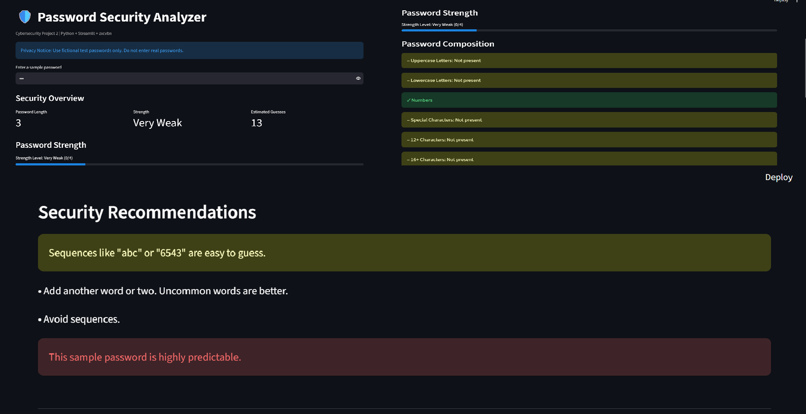
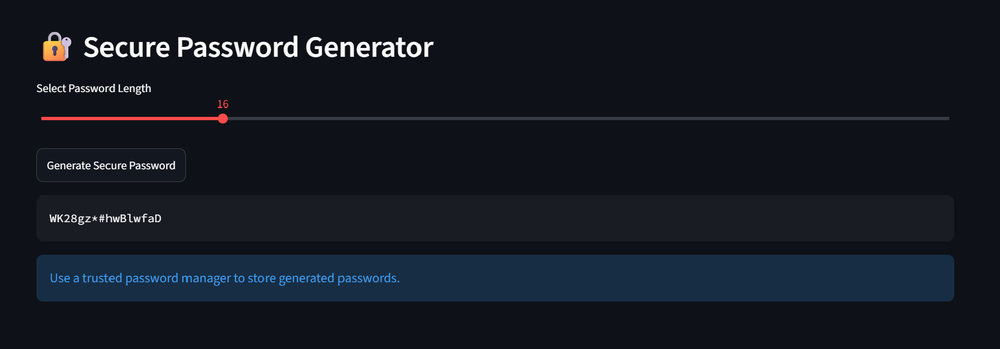

# Password Security Analyzer

A Python-based cybersecurity application for password strength estimation, security recommendations, and cryptographically secure random password generation.

## Project Overview

This application uses the zxcvbn password strength estimator to identify predictable password patterns and provide feedback.

It also includes a random password generator built using Python's `secrets` module and `SystemRandom`.

## Features

- Password strength estimation (0–4)
- Password length analysis
- Estimated password guesses
- Password composition analysis
- Security warnings and recommendations
- Configurable password generator (12–32 characters)
- Interactive Streamlit dashboard
- Automated unit testing using Pytest

## Technologies Used

- Python
- Streamlit
- zxcvbn
- Pytest

## Installation

1. Clone the repository.
2. Create a virtual environment:

   `python -m venv .venv`

3. Activate the environment on Windows:

   `.venv\Scripts\activate`

4. Install dependencies:

   `python -m pip install -r requirements.txt`

## Usage

Start the application:

`python -m streamlit run app.py`

Open the local URL displayed in the terminal, usually `http://localhost:8501`.

Use fictional passwords to explore the strength analyzer, or generate sample passwords with the random password generator.

## Automated Testing

Run:

`python -m pytest -v`

**Current test result: 11 tests passed.**

## Security and Privacy

- Do not enter real passwords into the demonstration application.
- The application does not intentionally save password inputs to files or a database.
- Strength estimates are not guarantees of password security.
- Use a trusted password manager for real account passwords.

## Future Improvements

- Password breach checking using a privacy-preserving approach
- Additional edge-case tests
- Improved UI and accessibility
- GitHub Actions automated testing

## Project Category

Cybersecurity | Python | Password Security | Secure Software Development

## Application Screenshots

### Password Strength Analysis

### Secure Password Generator
